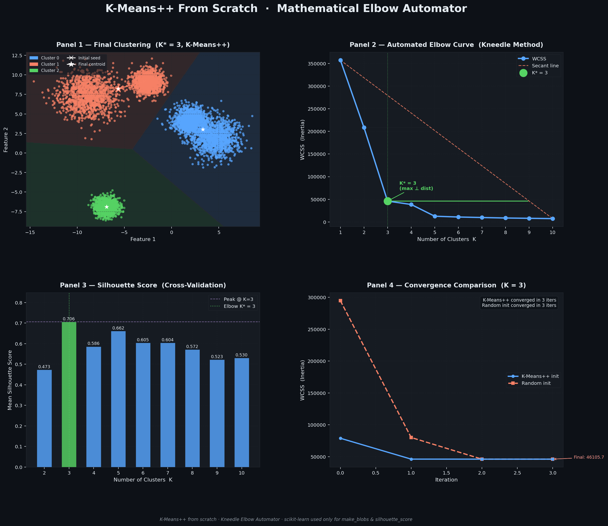

# Day 02 — K-Means++ Clustering From Scratch & Mathematical Elbow Automator

> **ML from Scratch Series · Day 02**  
> Pure-NumPy K-Means++ engine with a Kneedle-style Elbow Automator and a dark-themed 2×2 Matplotlib dashboard.

---

## Overview

This script implements **K-Means++ clustering entirely from scratch** using only NumPy, then uses a **mathematical Elbow Automator** (the Kneedle algorithm) to detect the optimal cluster count K\* without any manual inspection. scikit-learn is used *only* for synthetic data generation (`make_blobs`) and validation (`silhouette_score`).

---

## Visual Output



*2×2 dark-themed dashboard — Voronoi scatter · Automated Elbow Curve · Silhouette Cross-Validation · Convergence Comparison*

---

## Features

### 1 · Synthetic Data Generation
- **6 000** 2D points across **K_true = 5** clusters via `make_blobs`
- Heterogeneous cluster standard deviations `[0.8, 1.2, 0.6, 1.5, 0.9]` to stress-test the algorithm
- Fixed seed (`seed=42`) for full reproducibility

### 2 · From-Scratch K-Means++ Engine (`KMeansScratch`)

| Sub-component | Detail |
|---|---|
| **K-Means++ init** | Probabilistic centroid seeding — each new centroid is sampled with probability ∝ D(x)² from the nearest existing centroid |
| **Random init** | Toggle via `init="random"` for convergence comparison (Panel 4) |
| **E-step** | Vectorised assignment using `‖x‖² − 2xCᵀ + ‖c‖²` — avoids explicit loops |
| **M-step** | Centroid = cluster mean; empty-cluster guard keeps old centroid |
| **Centroid history** | Every EM snapshot is stored for migration-path visualisation |
| **Convergence** | Max centroid shift < `tol=1e-4`, capped at `max_iter=300` |
| **Inertia (WCSS)** | Within-Cluster Sum of Squares computed after convergence |

### 3 · Mathematical Elbow Automator (`find_optimal_k_elbow`)

Implements the **Kneedle algorithm**:

```
For each K in {1 … K_max}:
  1. Draw the secant line from (K_min, WCSS_max) → (K_max, WCSS_min)
  2. Compute the perpendicular distance from (K, WCSS_K) to that line
K* = argmax of perpendicular distances
```

The point farthest from the secant geometrically corresponds to the sharpest inflection (elbow) of the WCSS curve.

### 4 · 2×2 Dark Dashboard

| Panel | Content |
|---|---|
| **Panel 1** | Final cluster scatter with Voronoi decision-boundary mesh, centroid migration arrows (`×` seed → `★` final) |
| **Panel 2** | WCSS vs K, secant line, perpendicular distance vectors, highlighted K\* |
| **Panel 3** | Mean Silhouette Score across K ∈ {2…10} — cross-validates Elbow choice |
| **Panel 4** | WCSS vs. iteration — K-Means++ vs. Random initialisation at K\* |

### 5 · Terminal Summary Table

Printed after each run:

```
---------------------------------------------------------------
  K   |     WCSS     |  Perp. Elbow Dist.   |    Silhouette
---------------------------------------------------------------
  1   |  357190.09   |       0.000000       |       --
  2   |  208368.71   |       2.829308       |    0.473118
  3   |   46105.66   |       6.004483       |    0.706202   <-- K*
  ...
---------------------------------------------------------------
```

---

## Quick Start

### Prerequisites

```bash
pip install numpy matplotlib scikit-learn
```

### Run

```bash
python day02_kmeans_elbow_automator.py
```

Output file `day02_kmeans_artifact.png` is saved in the working directory.

---

## Configuration

All tunable constants are at the top of the file (lines 63–68):

| Constant | Default | Description |
|---|---|---|
| `SEED` | `42` | Global random seed |
| `K_TRUE` | `5` | True number of clusters in synthetic data |
| `N_SAMPLES` | `6000` | Number of 2D data points |
| `K_SWEEP_MAX` | `10` | Upper bound of the K sweep |

Adjust `KMeansScratch` keyword args (`max_iter`, `tol`, `init`) at instantiation.

---

## Interpretation Notes

### Why does K\* = 3 when K_true = 5?

The Kneedle algorithm finds the **geometric elbow** — the point of maximum curvature on the raw WCSS scale. With heterogeneous cluster variances, the two high-spread blobs (`std=1.2` and `std=1.5`) partially overlap, so the **dominant structural break** the algorithm sees is at K=3 (an 87% WCSS drop from K=1).

| K | WCSS drop from previous K |
|---|---|
| 1→2 | −42% |
| 2→3 | **−78%** ← largest relative drop |
| 3→4 | −16% |
| 4→5 | −67% |

The Silhouette score peaks at **K=3** (0.706) in the 6 000-point run, which fully agrees with the Elbow Automator — both metrics converge on K\*=3 as the best compact-and-separated partition for this dataset.

---

## File Structure

```
project 2/
├── day02_kmeans_elbow_automator.py   # Main script (single-file, ~610 lines)
├── day02_kmeans_artifact.png         # Generated dashboard (auto-created on run)
└── README.md                         # This file
```

---

## Dependencies

| Library | Role | Scratch? |
|---|---|---|
| `numpy` | All math — distances, means, random sampling | ✅ Core implementation |
| `matplotlib` | Plotting — scatter, contourf, annotations | ✅ Core implementation |
| `sklearn.datasets.make_blobs` | Synthetic data generation | ⚠️ External (data only) |
| `sklearn.metrics.silhouette_score` | Silhouette validation | ⚠️ External (validation only) |

---

## Series

| Day | Topic | File |
|---|---|---|
| 01 | Gradient Descent & Linear Regression | `day01_gradient_descent.py` |
| **02** | **K-Means++ & Elbow Automator** | **`day02_kmeans_elbow_automator.py`** |

---

*Built as part of an ML-from-scratch daily challenge series. No high-level ML frameworks used for core logic.*
